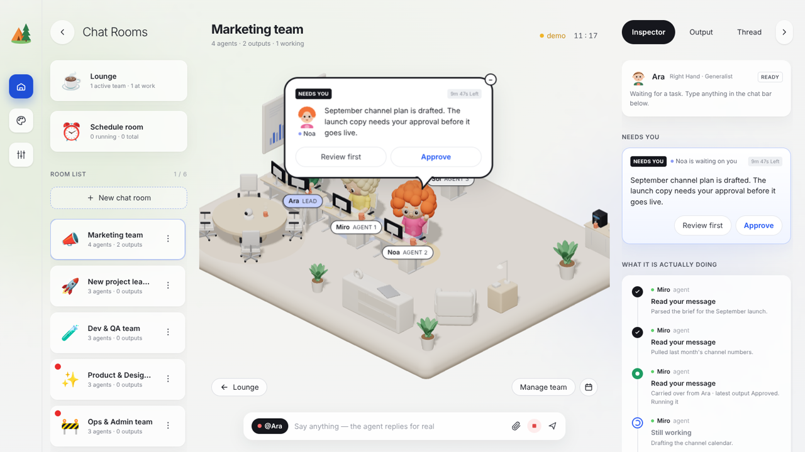
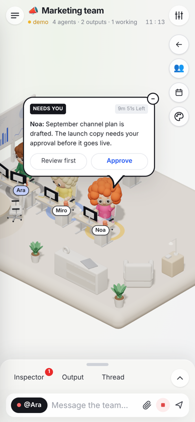
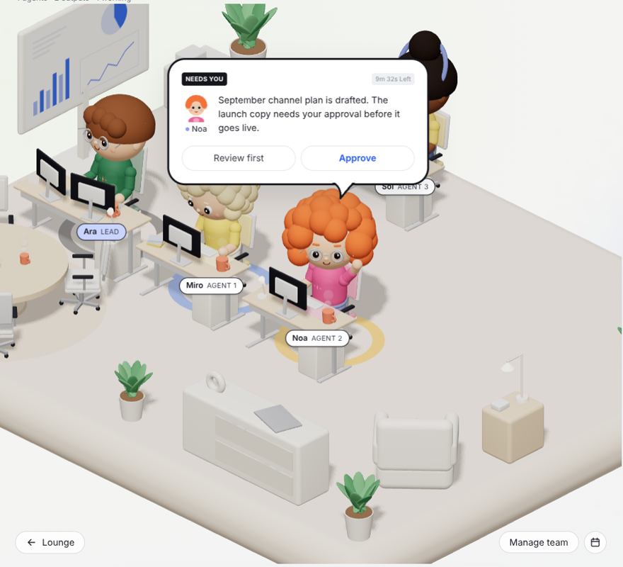

# Hermes Office — Design Document

> **خلاصه به فارسی:** این سند معماری، سیستم طراحی (رنگ، تایپوگرافی، فاصله‌ها)، مدل داده، منطق ارتباط با agentها، و ساختار صحنهٔ سه‌بعدی (واحدها، مختصات، چیدمان، مسیر راه‌رفتن) را توضیح می‌دهد. بخش «Extension recipes» قدم‌به‌قدم می‌گوید برای افزودن هر عنصر جدید (مبلمان، مدل مو، وضعیت جدید agent، تب جدید پنل، بک‌اند جدید، تم و …) کدام فایل‌ها را و چطور تغییر دهید.

This document is the reference for anyone (human or agent) who extends the office. Read §1–§3 once; jump to §9 for step-by-step recipes.

---

| Desktop | Phone | Workstations close-up |
| --- | --- | --- |
|  |  |  |

## 1. Product in one paragraph

A 3D isometric virtual office where every **chat room is a team** of AI agents. Agents sit at personal desks, type while they work, stand up and walk over to hand off tasks, ask the human for approval in a speech bubble, and celebrate on approval. The dashboard shows each agent's live steps ("What it is actually doing"), deliverables (Output) and the conversation (Thread). Two interchangeable backends drive the agents: **hermes-agent** (OpenAI-compatible API) and **Claude Code** (Agent SDK, native subagents).

## 2. Architecture

```
Browser (React 19, Next.js App Router, client components)
 ├─ components/office/OfficeApp.tsx      app shell: desktop / tablet / phone layouts
 │   ├─ RoomPanel        rooms list (sidebar or phone drawer)
 │   ├─ OfficeScene      react-three-fiber canvas + DOM overlays
 │   ├─ RightPanel       Inspector / Output / Thread (side panel, tablet overlay, phone sheet)
 │   ├─ ChatBar          @agent target, attachments, stop
 │   └─ Modals           team editor, connections, theme
 └─ lib/store.ts         single store (useSyncExternalStore) + orchestration + localStorage

Next.js server (Node runtime)
 ├─ proxy.ts                     password gate for every page and API (OFFICE_PASSWORD)
 ├─ app/api/login|logout         session cookie (HMAC-signed, 30 days)
 ├─ app/api/health               public liveness JSON
 ├─ app/api/hermes               → hermes-agent POST /v1/chat/completions (SSE passthrough, demo fallback)
 ├─ app/api/hermes/health        → hermes-agent GET /v1/models
 ├─ app/api/claude-code          → @anthropic-ai/claude-agent-sdk query(), converted to OfficeEvents (SSE)
 └─ app/api/claude-code/agents   lists .claude/agents/*.md subagents
```

Secrets (API keys, password) live only in server env. The browser never talks to a backend directly.

## 3. Data model (`lib/types.ts`)

| Type | Key fields | Notes |
| --- | --- | --- |
| `OfficeState` | `rooms, activeRoomId, view, selectedAgentId, targetAgentId, rightTab, schedules, theme, roomsCollapsed, panelCollapsed, focusOutputId, fx` | whole UI state; persisted to `localStorage["hermes-office-v2"]` (minus `fx`, running flags) |
| `Room` | `backend, agents[], messages[], steps[], approvals[], outputs[], ccSessionId, costUsd` | a team |
| `Agent` | `name, title, persona, isLead, status, look, subagentId, source, activity` | `status`: idle · working · needs_you · done |
| `AgentLook` | `skin, hair, hairStyle, shirt, accent, pants, glasses` | drives the 3D character and 2D avatar |
| `Step` | `agentId, title, description, status (done/running/pending), progress, handoff` | timeline rows |
| `Approval` | `agentId, text, outputId, expiresAt, status` | "Needs you" (10 min TTL) |
| `Output` | `agentId, title, content (markdown), status (draft/approved)` | deliverables |
| `Fx` | `kind (handoff/celebrate), from, to, agentId, ts` | short-lived scene effects (8 s) |

**Versioning:** when you change a persisted shape incompatibly, bump `STORAGE_KEY` in `lib/store.ts` or add a migration in `hydrate()` (it already defaults `backend` for old rooms).

## 4. Orchestration (`lib/store.ts`)

* `sendMessage(roomId, text, targetAgentId)` → adds the user message, then `runHermes` or `runClaudeCode` by `room.backend`. `@Name` at the start overrides the target.
* **`AgentRun`** is the unit of work for one agent reply: creates the streaming message + "Read your message" + running "Still working" step; `append(delta)` parses markers live; `tool(name, detail)` adds "Used X" steps and sets `agent.activity`; `finish()` turns markers into outputs/approvals and sets status; `fail()`.
* **hermes:** the lead may emit `[[DELEGATE: Name | task]]`; each delegation pushes a `handoff` fx (walk + paper) and runs the teammate (max depth 2).
* **Claude Code:** the lead is the main thread, teammates are subagents. Server events: `session, text, tool, subagent_start, subagent_progress, subagent_end, result, error, done` (`lib/office-events.ts`). Unknown subagent types join the room automatically (`agentForSubagent`). Background subagents end on `task_notification`.
* Actions (`actions.*`): selectRoom, selectAgent, addRoom, removeRoom, renameRoom, setAgents, clearRoom, approve (→ celebrate fx + "Approved" message), reject, reviewFirst, expireApprovals, set(key, value).

### Office markers (`lib/protocol.ts`)

| Marker | Effect |
| --- | --- |
| `[[STEP: title \| description]]` | finished step in the timeline |
| `[[OUTPUT: title]]` + text | output card (draft if an approval follows) |
| `[[NEEDS_APPROVAL: summary]]` | approval bubble + Needs-you card, agent status `needs_you` |
| `[[DELEGATE: Name \| task]]` | hermes rooms only: hand-off to a teammate |

Markers are stripped from visible text (`stripDirectives`), including half-streamed ones.

## 5. Visual design system

### Tokens

| Token | Value | Use |
| --- | --- | --- |
| ink | `#16171d` / text `#1d1f26` | primary text, active tab, badges, bubble border |
| muted | `#7a7e89`, `#6c707b`, `#4e525d` | meta text, section titles |
| line | `#e3e5ea`, `#d9dbe0` | borders, pill buttons |
| surface | `white/75–90` + `backdrop-blur` | cards & panels |
| background | radial `#eef3ea → #f4f4f2 → #f2f3f5` + soft blobs | page |
| accent | `#2156f3` (text), `#4f7cf5` (UI), `#1f4fd6` (rail active) | approve, progress, focus |
| success | `#1f9d63` / `#2fbf71` | live, done ring, approved |
| warning | `#f5a524` / `#c98a12` | demo/offline, needs-you ring and "!" |
| danger | `#ea2b2b` / `#e04848` | unread dot, stop, errors |
| floor themes | cream `#f1e8dc`, mint `#e1efe6`, lavender `#e9e5f4`, sky `#e1ebf6` | `THEME_FLOOR` / `THEME_RUG` |

Type: Inter → system UI stack (`app/globals.css`). Sizes: room title 25/700, panel tabs 14.5, body 13–14.5, meta 11.5–12.5, badges 10/700 uppercase. Radii: pills `full`, cards 14–16px, bubble 28px (phone 20px), modals 22px. Shadows are soft and low-contrast (`0 10px 30px rgba(20,22,30,.05)`).

### Layout & breakpoints

| Viewport | Layout |
| --- | --- |
| ≥ 1800px | rail 108 · rooms 320 · scene · panel 380 |
| 1280–1799 | rail 84 · rooms 272 · scene · panel 340 (rooms fold below 1440) |
| 768–1279 | rooms folded to emoji column; right panel opens as an **overlay** |
| phone (`max-width: 767px` or `max-height: 500px`) | top bar · scene (camera fits the agents, pinch/pan) · **bottom sheet** tabs (landscape: **side panel**) · chat bar · rooms **drawer** |

## 6. 3D scene (`components/office/OfficeScene.tsx`)

### Coordinates and units

* World: y up; floor platform 15.5 (x) × 12.5 (z) centred at the origin, top at y = 0.
* Camera: orthographic, direction from `(20, 17, 20)` (≈35° elevation). On screen: **−x−z = back/top, +x+z = front/bottom, +x−z = right, −x+z = left**. Orbit is limited (azimuth 0.2–1.35, polar 0.6–1.15).
* Agents and workstations are modelled in **chibi units** and placed inside a group scaled by `S = 1.35`. In chibi units a character sits at the origin facing **+z**: hip 0.6, seat top 0.46, desk top 0.8, head centre 1.69.

### Zones (world units)

| Zone | Where |
| --- | --- |
| Desk rows | row B `z = 0.4`, row A `z = −5.0`; columns `x = −4.6 (lead, row B), −1.6, 1.3, 4.2` |
| Aisles (keep free!) | behind each row: `z = row − 1.15`; gaps between desks: `x = deskX − 1.45` |
| Whiteboard + cabinet | left edge `x = −7.0` |
| Meeting table | centre `(−4.4, 4.0)`, 4 seats at radius 1.75 (overflow seats for agents 9+) |
| Lounge | coffee `(6.6, −5.2)`, side cabinet `(6.8, 0.9)`, armchair `(6.2, 3.0)`, bookshelf `(3.8, 5.0)` |
| Plants | corners + `(0.6, 5.2)` |

### Seats and spots

`DESKS` (assignment order: lead, then the most visible desks) then meeting seats → `SPOTS`. Agent *i* (lead first) gets `SPOTS[i]`. Only occupied desks are rendered.

### Movement

`routeBetween(from, to)` walks: stand up → step behind the chair → along the row aisle → through the gap left of the target desk → stand beside the target. `handoffTiming()` = stand-up 0.45 s + walk (2.4 u/s) + talk 2.2 s + walk back + sit. `PaperFlight` starts on arrival.

### Characters (`Character.tsx`)

Jointed rig: pelvis; legs = hip joint → thigh → knee joint → shin → shoe; torso pivot (lean) with belt, collar, neck; arms = shoulder joint → upper arm → elbow joint → forearm → hand; head with ears, sclera/iris/highlight eyes (blink), brows (raise on needs_you), cheeks, nose, smile, optional glasses (rims, lenses, temples), hair styles (`short, curly, fluffy, bun, bob, buzz` + headphones on buzz).
Poses come from `status` + `Motion` (`walking, seated, talking, look, celebrateAt`), blended every frame: typing (working, seated), relaxed (idle), wave (needs_you), talk gesture (hand-off), cheer (approval), walk cycle.

### Furniture (`Furniture.tsx`, `Workstation.tsx`)

`Workstation` (desk + frame + drawers + mat + keyboard texture + mouse + monitor(s) + mug + personal item + `OfficeChair`), `DeskMonitor` (code texture scrolls when `active`), `OfficeChair` (5-star base, casters, cushion tint, executive back), `CoffeeStation`, `Whiteboard`, `RoundTable`, `Bookshelf`, `Armchair`, `SideCabinet`, `Cabinet`, `Plant` (sways), `Mug` (steam), `Rug`, `Floor`. Helper `M` = `meshStandardMaterial`; `soft(color, k)` lightens a color.

### Overlays (`Overlay.tsx`)

HTML pinned to 3D points without extra React roots: put `<Anchor id="…">` in the scene, `<Overlay id="…">` next to the canvas; `Projector` positions them each frame (`ax/ay` alignment, optional `clamp` to stay in view). Agent anchors: `${agent.id}:label`, `:above`, `:bubble`.

### Effects (`Effects.tsx`)

`StatusRing` (working blue, needs_you amber, done green, selected ink), `PaperFlight`, `Confetti`.

## 7. Server & security

* `proxy.ts` protects everything except `/login`, `/api/login`, `/api/health`, static files. Session cookie `office_session = <expiry>.<HMAC-SHA256>` signed with `OFFICE_SESSION_SECRET`. Login is rate limited (8 tries / 10 min / IP).
* Claude Code backend runs tools on the server: **off in production unless `CLAUDE_CODE_ENABLED=true`**; prefer `acceptEdits`/`plan` permission modes.
* Streaming responses must not be buffered by proxies (`flush_interval -1` in Caddy).

## 8. Environment variables

| Var | Default | Purpose |
| --- | --- | --- |
| `OFFICE_PASSWORD` | – | enables the login gate (required in production) |
| `OFFICE_SESSION_SECRET` | derived | cookie signing |
| `OFFICE_INSECURE_COOKIE` | false | allow non-HTTPS cookies (testing only) |
| `HERMES_API_URL` / `HERMES_API_KEY` / `HERMES_MODEL` | – / – / `hermes-agent` | hermes-agent API server |
| `CLAUDE_CODE_ENABLED` | dev on, prod off | Claude Code backend |
| `CLAUDE_CODE_CWD` / `_MODEL` / `_PERMISSION_MODE` / `_MAX_TURNS` | cwd / default / acceptEdits / 40 | Claude Code options |
| `PORT`, `HOSTNAME` | 3000, 127.0.0.1 | standalone server bind |

## 9. Extension recipes

Each recipe lists every file to touch. Run `npm run typecheck && npm run lint && npm run build` after.

1. **New furniture item** — add a component to `Furniture.tsx` (world units) or `Workstation.tsx` (chibi units, then place inside a `scale={S}` group). Use `M`, `RoundedBox`, `castShadow`/`receiveShadow`. Place it in the "furniture" section of `OfficeScene.tsx` outside the aisles (§6). Animated parts: `useFrame` + refs, never React state.
2. **New personal desk item** — add a `case` in `PersonalItem` (`Workstation.tsx`) and raise the `% 5` modulo.
3. **More desks / different layout** — edit `ROW_A`, `ROW_B`, `DESKS`; keep `routeBetween` assumptions (people face +z, aisle behind each row, gap left of each desk) or update it.
4. **New hair style** — extend `HairStyle` (`lib/types.ts`), add a branch in `Hair` (`Character.tsx`), a 2D version in `AgentAvatar.tsx`, and the option list `HAIR` in `Modals.tsx`.
5. **New accessory (hat, scarf…)** — add an optional field to `AgentLook`, render it in `Head`/torso in `Character.tsx`, add a control in `TeamEditor`, optionally a preset in `LOOK_PRESETS` (`lib/seed.ts`). Optional fields need no migration.
6. **New agent status** — extend `AgentStatus`; add `STATUS_LABEL`/`STATUS_TEXT` (`RightPanel.tsx`), a ring color in `RING` (`Effects.tsx`), a pose branch in `Character.tsx`, and set it in `AgentRun` (`lib/store.ts`).
7. **New office marker** — document it in `MARKERS` (`lib/protocol.ts`), extend the regex `RE` and `Directive`, handle it in `AgentRun.finish()`.
8. **New panel tab** — add to `TABS` and `TAB_ICON` (`RightPanel.tsx`), a branch in `PanelContent`, and the union of `OfficeState.rightTab`.
9. **New backend** (e.g. another agent framework) — add to `Backend` (`lib/types.ts`); create `app/api/<name>/route.ts` that streams either OpenAI-style SSE (reuse `streamChat` + `AgentRun` like `runHermes`) or `OfficeEvent`s (reuse the `runClaudeCode` pattern); branch in `sendMessage`; add it to the backend picker in `TeamEditor`, the header badge in `OfficeApp.tsx` and `/api/health`.
10. **New theme** — extend `SceneTheme`, add colors to `THEME_FLOOR` and `THEME_RUG`.
11. **New scene effect** — extend `Fx.kind`, call `pushFx` in the store, render it in the effects block of `OfficeScene.tsx` (keep it time-based on `ts`).
12. **New room template** — add an `emptyRoom(...)` in `seedState()` (`lib/seed.ts`) and bump `STORAGE_KEY` if existing users should see it.
13. **Shared state across devices** — today state is per-browser `localStorage`. Replace `persist()`/`hydrate()` in `lib/store.ts` with a server store (e.g. SQLite + `/api/state`), keeping the same `OfficeState` shape.
14. **New UI copy / language** — strings are inline in components; for i18n, extract to a dictionary and wrap with a `t()` helper.

## 10. Quality checklist before shipping a change

* `npm run typecheck`, `npm run lint`, `npm run build` all clean.
* Desktop 1920×1080 and 1440×900, tablet 1024×768, phone 390×844 and 844×390: no overlap of labels, bubble stays in view, sheet/drawer open & close.
* Send a message in a demo room: lead walks to a teammate, paper flies, approval bubble appears, Approve → confetti.
* `deploy/verify.sh` against the running server.
